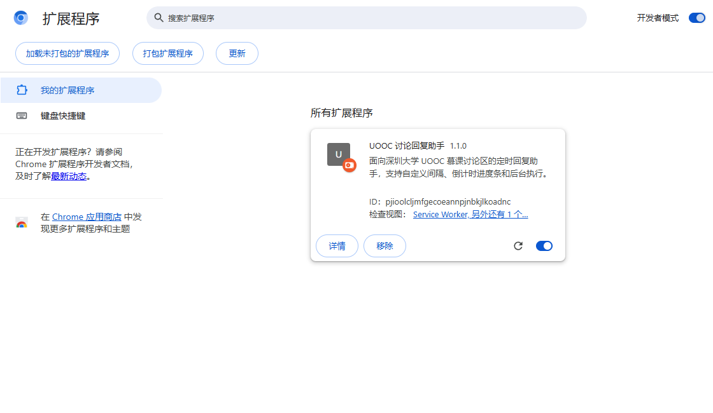
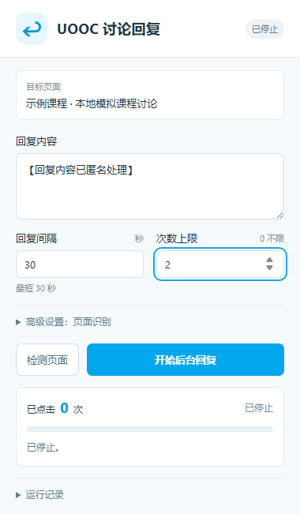
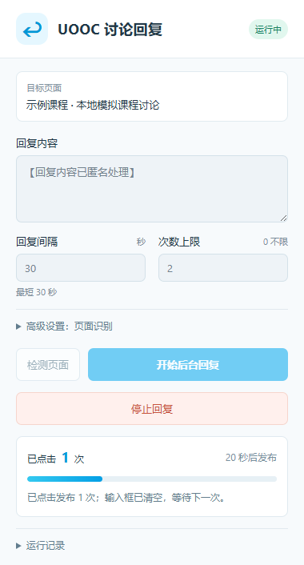
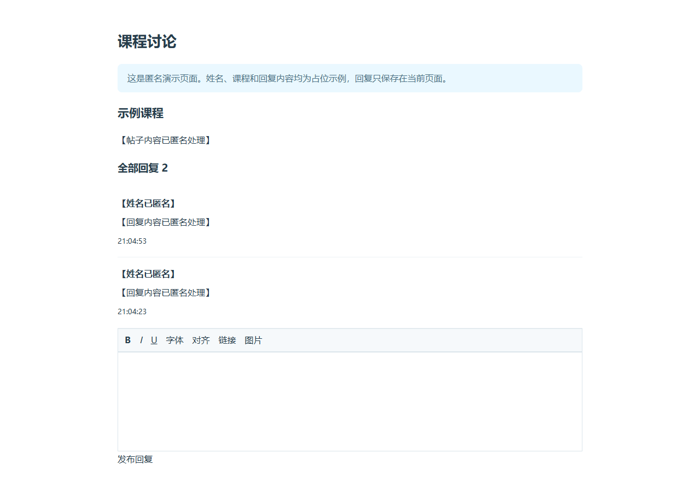

# 使用教程

本插件用于深圳大学 UOOC 慕课讨论区定时回复、刷讨论次数。截图均为本地演示，姓名、课程和回复内容已替换为匿名占位信息。

## 1. 下载并安装

安装包或 GitHub 源码 ZIP 都应先解压。

| 浏览器 | 扩展管理地址 |
| --- | --- |
| Google Chrome | `chrome://extensions` |
| Microsoft Edge | `edge://extensions` |

输入对应地址，打开右上角「开发者模式」，点击「加载已解压的扩展程序」，选中 **extension 文件夹**。文件夹内应直接包含 `manifest.json`，不要选 ZIP 文件。



看到「UOOC 讨论回复助手」卡片即安装完成。从浏览器工具栏的扩展菜单中打开，也可以固定到工具栏。

## 2. 打开课程帖子

登录自己的 UOOC 账号，进入目标课程「课程讨论 → 综合讨论」，打开需要回复的帖子，确认页面下方有输入区域和「发布回复」按钮。启动前清空上次失败留下的草稿。

## 3. 填写参数

打开面板，目标页面应是该课程帖子。



| 参数 | 填写方式 |
| --- | --- |
| 回复内容 | 改为自己的讨论内容，满足课程页面字数要求 |
| 回复间隔 | 30～86400 秒的整数，默认 70 |
| 次数上限 | 首次测试填 `1`，想发 5 次填 `5`，持续运行填 `0` |

「高级设置」通常留空；识别失败时再填写 CSS 选择器。

## 4. 检测并开始

点击「检测页面」，这一步只读取页面，不会发布。检测成功后点「开始后台回复」，允许扩展访问当前课程网站。

**第一条立即发送**，UEditor 会预留约 1 秒同步数据；后续按设定间隔执行。次数上限包含第一条，设为 `1` 时发一条后就停止。

## 5. 看进度和结果



进度条从左向右推进，右侧显示剩余秒数；同步或发布时显示「正在发布…」。关闭再打开面板，会恢复后台保存的倒计时进度。

可以关闭面板、切换标签页或最小化。保留课程标签页，保持浏览器运行、账号登录、电脑唤醒联网。持续运行时，可将课程网站加入浏览器性能设置中的「始终保持活动」名单。

回到帖子核对新回复及课程统计。下面是匿名演示结果，展示的不是实际课程记录。



## 6. 停止、调整和更新

再次打开面板，点击「停止回复」可取消下一轮；已经发出的请求无法撤回。修改内容、间隔或次数时，先停止，改好后再开始。重新开始会立即发第一条，达到上限会自动停止。

升级版本：停止任务 → 覆盖原 `extension` 文件夹 → 扩展管理页「重新加载」→ 回到帖子重新检测。

## 常见问题

### 找不到发布按钮

在「高级设置 → 发布按钮 CSS 选择器」填入：

```css
.release[ng-click]
```

它对应已适配的 UOOC 按钮 `<div class="release" ng-click="handleRelease()">发布回复</div>`。输入框已能识别时保持其设置不变。页面改版时，右键实际按钮 → 检查 → Copy outerHTML，可用元素结构排查。

### 草稿有文字，网站却提示不足 5 字

确认已安装并重新加载新版。当前版本通过 UEditor 接口、内容事件和 AngularJS 表单同步数据，运行记录显示写入方式及字数。

清空失败草稿，上限设为 `1` 再试。仍报错时提供运行记录和输入框 HTML，尽量包含 `iframe`、`contenteditable` 或 `ng-model` 容器。加粗、字号等工具栏并非实际输入框。

### 多个输入框或多个按钮

用高级设置中的 CSS 选择器限定目标，再检测，确保只有一个输入框和发布按钮。

### 提示已有草稿

先核对上一条的结果，再手动清空草稿。插件不会覆盖已有内容。

### 进度条走满仍未发布

浏览器可能延迟后台任务，此时显示「等待执行…」。如果暂停，查看运行记录。睡眠、冻结、掉线或登录失效均会影响执行；不会补发休眠积压的次数。[浏览器计时说明](https://developer.chrome.com/docs/extensions/reference/api/alarms)

### 点击次数到了，课程统计没增加

面板记录的是点击次数。实际发布和讨论次数以帖子及平台课程统计为准，插件无法决定平台的计数规则。

### 页面包含跨域 iframe

没有实际表单的访问权限时，可把包含讨论表单的 iframe 页面单独在新标签页打开，再从该页运行。自动识别支持同源 iframe。

## 本地演示

在项目根目录运行 `python -m http.server 8765 --bind 127.0.0.1`，访问 `http://127.0.0.1:8765/demo/`，在插件中设置上限 `1` 并开始。演示只在本地显示回复，不向 UOOC 发布。结束后 Ctrl+C 关闭服务器。
